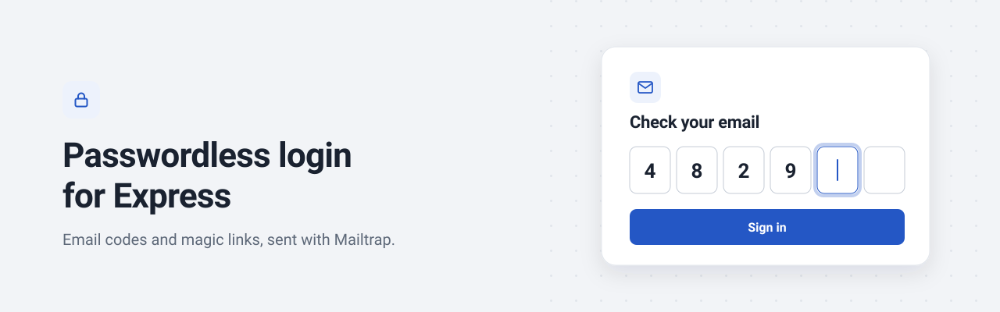
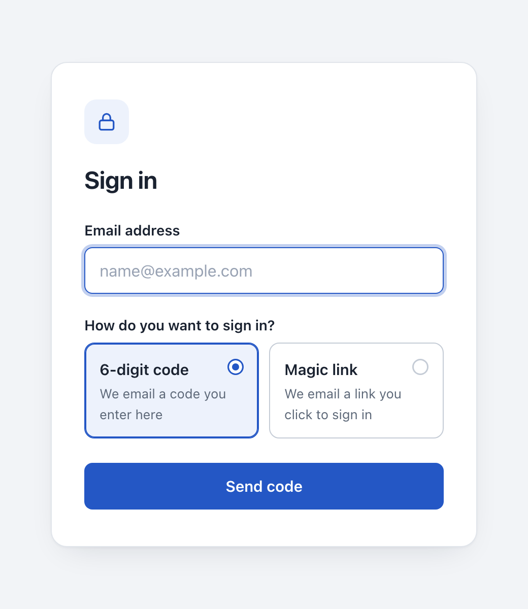
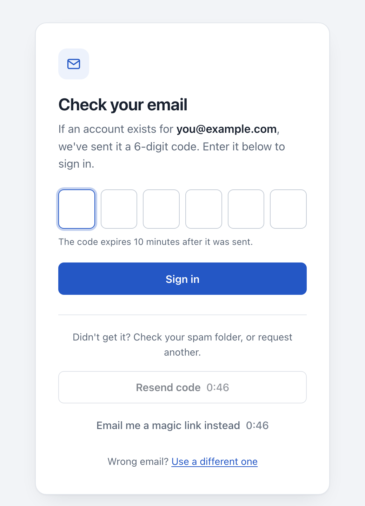
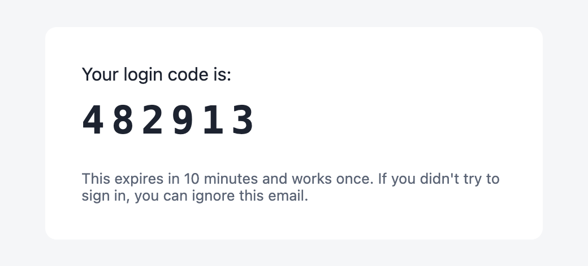
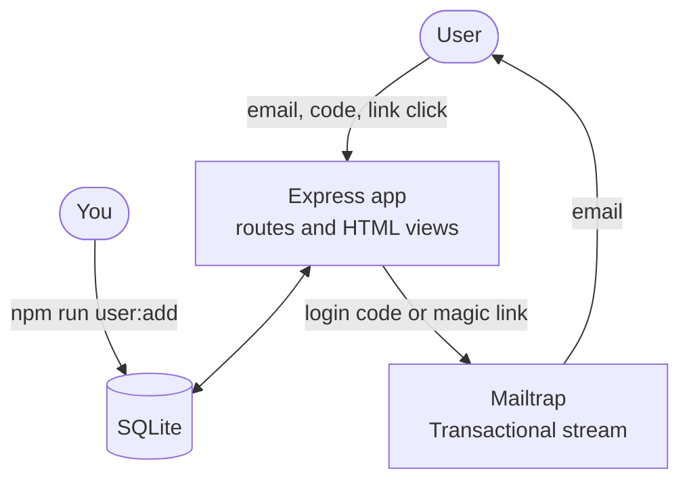
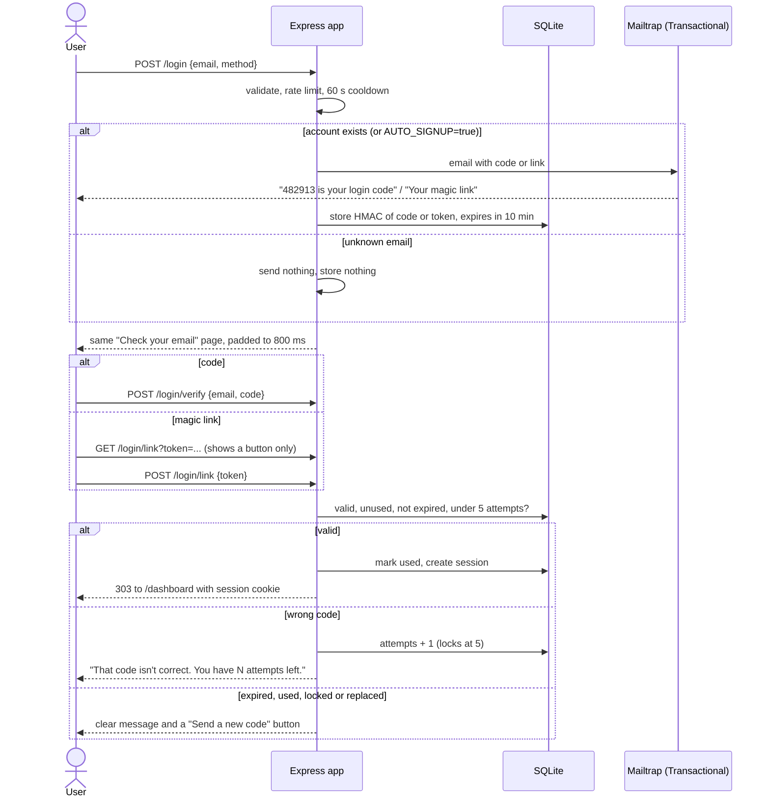

<p align="center">
  
</p>

# Passwordless Login with Email OTP and Magic Link in Express (Mailtrap)

A secure passwordless login for Node.js apps: users enter their email and sign in with a 6-digit code or a magic link. Built with Express, TypeScript and SQLite, with hashed single-use codes, expiry, attempt limits and rate limiting, and login emails delivered through the Mailtrap Email API Transactional stream.

<p>
  
  
  
  
  
  
</p>

**Contents:** [Demo](#demo) · [How it works](#how-it-works) · [Features](#features) · [Stack](#stack) · [Prerequisites](#prerequisites) · [Mailtrap setup](#mailtrap-setup) · [Quick start](#quick-start) · [Key integration points](#key-integration-points) · [Failure behavior](#failure-behavior) · [Security design](#security-design) · [Configuration](#configuration) · [Tests](#tests) · [Deploying](#deploying-to-production) · [FAQ](#faq)

## Demo

| Sign in                                                                                   | Enter the code                                                                                         | Login email                                                                           |
| ----------------------------------------------------------------------------------------- | ------------------------------------------------------------------------------------------------------ | ------------------------------------------------------------------------------------- |
|  |  |  |

The screenshots come from a local run. The email is `src/email/templates.ts` rendered with a sample code.

## How it works

The app is a single Express server that renders HTML on the server. Users sign in in the browser, you add users from the command line, and Mailtrap delivers the login emails. Everything is stored in one SQLite database.



| Part           | What it does                                                               | Where                       |
| -------------- | -------------------------------------------------------------------------- | --------------------------- |
| Routes         | Login form, code check, magic link, dashboard and logout                   | `src/routes`                |
| Request login  | Rate limits, cooldown, generating and sending the code or link             | `src/auth/requestLogin.ts`  |
| Challenges     | Hashed codes and tokens, expiry, attempts, single use                      | `src/auth/challenges.ts`    |
| Sessions       | Random session ids, stored as SHA-256, cookie handling, `requireSession`   | `src/auth/sessions.ts`      |
| Rate limits    | Fixed-window counters and the resend cooldown, stored in SQLite            | `src/auth/rateLimit.ts`     |
| Mailer         | The only code that talks to Mailtrap                                       | `src/email/mailtrap.ts`     |
| Views          | Server-rendered HTML with escaping, plus a small progressive script        | `src/views`                 |
| Database       | Users, login challenges, sessions, rate limit counters                     | `src/db.ts`                 |

### Email to signed in

The user picks a 6-digit code or a magic link. Only that credential is generated, emailed and stored.



## Features

- **Code or magic link.** The user chooses on the login page. Only the chosen credential is generated, emailed and stored, and the user can switch from the "Check your email" page.
- **Hashed, single-use secrets.** Codes and tokens are stored only as `HMAC-SHA256(OTP_SECRET, …)`, expire after 10 minutes and are consumed with one conditional `UPDATE`.
- **Attempt limits.** A code locks after 5 wrong tries, after which even the correct code fails.
- **Rate limits and cooldown.** Requests are limited to 5 per email and 20 per IP every 15 minutes, and verifications to 60 per IP. There is a 60-second resend cooldown, shown as a live timer on the resend buttons.
- **No account enumeration.** Known and unknown emails get the same page, status and cooldown. Unknown emails get no email and no stored record.
- **Scanner-safe magic links.** Opening the link only shows a "Continue signing in" button. Email security scanners that open links can't use them up.
- **Server-side sessions.** The cookie holds a random 256-bit id and the database stores only its SHA-256 hash. Cookies are `HttpOnly`, `SameSite=Lax`, and `Secure` on https, and sessions last 7 days.
- **Redacting logger.** Codes, tokens, links and email bodies never appear in logs, and email addresses are masked.
- **Polished, accessible UI.**
  - six-box code entry with paste support and auto-submit
  - loading states and keyboard focus styles
  - reduced-motion support
  - works without JavaScript

## Stack

|            |                                                                                                    |
| ---------- | -------------------------------------------------------------------------------------------------- |
| App        | Express 5, TypeScript (strict), server-rendered template-literal HTML                              |
| Data       | SQLite via better-sqlite3, migrations on startup                                                   |
| Validation | Zod for environment variables and form input                                                       |
| Email      | [`mailtrap`](https://github.com/railsware/mailtrap-nodejs) Node.js SDK, Transactional stream       |
| Crypto     | Node's built-in `crypto`: `randomInt`, `randomBytes`, HMAC-SHA256, `timingSafeEqual`               |
| Tooling    | Vitest, Supertest, tsx                                                                             |

The only runtime dependencies are express, better-sqlite3, zod, mailtrap and dotenv. There is no session, cookie or rate-limit library and no ORM.

## Prerequisites

- Node.js 20 or newer
- A [Mailtrap](https://mailtrap.io) account (the free plan is enough to try everything)

## Mailtrap setup

1. **Create an API token.** In Mailtrap go to Settings, API Tokens, and create a token with access to your sending domain.
2. **First run on the demo domain.** New accounts get a demo sending domain, `demomailtrap.co`. Set `MAIL_FROM_EMAIL=hello@demomailtrap.co` and sign in with your own Mailtrap account email. The demo domain delivers only to the account owner, so this is a safe way to see the whole flow without touching real addresses. Mail from a shared demo domain often lands in spam.
3. **Verify your own domain to email anyone.** Add your domain under Sending Domains and create the DNS records Mailtrap shows (SPF, DKIM, and a DMARC record). Then set `MAIL_FROM_EMAIL` to an address on it. If the sender isn't on one of your domains, Mailtrap answers `Unauthorized` even when the token is valid.
4. **Know the free plan limits.** The free plan allows 4,000 emails a month and 150 a day. Anything over the daily limit is rejected. See [Mailtrap sending limits](https://docs.mailtrap.io/email-api-smtp/setup/sending-limits).

## Quick start

```bash
git clone https://github.com/manishgupta412/express-mail-otp-login.git && cd express-mail-otp-login
npm install
cp .env.example .env                      # set MAILTRAP_TOKEN, MAIL_FROM_EMAIL and OTP_SECRET
node -e "console.log(require('crypto').randomBytes(48).toString('base64url'))"   # paste as OTP_SECRET
npm run user:add -- you@example.com       # needed while AUTO_SIGNUP=false
npm run dev
```

Open http://localhost:3000/login. The database is created at `./data/app.db` on startup and migrated automatically. Open magic links on the same computer that runs the server: `APP_URL` is `localhost` until you deploy.

## Key integration points

**One email, one stream.** The client is created without `bulk` or `sandbox`, so the SDK sends to the Transactional stream at `send.api.mailtrap.io`. Each email is tagged so codes and links can be told apart in Mailtrap stats ([`src/email/mailtrap.ts`](src/email/mailtrap.ts)):

```ts
const client = new MailtrapClient({ token: opts.token });

await client.send({
  from: { email: opts.fromEmail, name: opts.fromName },
  to: [{ email: email.to }],
  subject,
  text,
  html,
  category: email.method === "code" ? "login-code" : "login-link",
});
```

**Store only after a successful send.** If Mailtrap throws, the user sees "We couldn't send the email, try again" and nothing is written. Only an accepted email creates a challenge, and it replaces any older open one ([`src/auth/requestLogin.ts`](src/auth/requestLogin.ts)).

**Hash with a key, compare in constant time.** A 6-digit code has only a million values, so a plain SHA-256 could be reversed instantly from a leaked database. A keyed HMAC can't be reversed without `OTP_SECRET` ([`src/auth/crypto.ts`](src/auth/crypto.ts), [`src/auth/challenges.ts`](src/auth/challenges.ts)):

```ts
export function hmac(secret: string, purpose: string, value: string): string {
  return crypto.createHmac("sha256", secret).update(`${purpose}:${value}`).digest("hex");
}

if (!safeEqualHex(this.hashCode(email, code), row.code_hash)) {
  // attempts + 1, lock at 5
}
```

**Consume atomically.** Two parallel requests with the same code can't both succeed. Only the one that flips `used_at` from `NULL` gets a session ([`src/auth/challenges.ts`](src/auth/challenges.ts)):

```sql
UPDATE login_challenges SET used_at = ?
WHERE id = ? AND used_at IS NULL AND invalidated_at IS NULL
  AND attempts < ? AND expires_at > ?
-- require changes === 1
```

**Pad the response time.** `POST /login` and `/login/resend` never answer in less than 800 ms. A known email therefore doesn't come back noticeably slower than an unknown one ([`src/routes/login.ts`](src/routes/login.ts)):

```ts
const remaining = deps.minResponseMs - (performance.now() - started);
if (remaining > 0) await sleep(remaining);
```

## Failure behavior

What happens when something goes wrong, so you know what to expect.

| Situation | What the app does |
| --- | --- |
| Login email fails to send | The user sees "We couldn't send the email, try again" (HTTP 502) and can retry at once. Nothing is stored and the 60 s cooldown is released. The attempt still counts toward rate limits. |
| Mailtrap answers `Unauthorized` | Usually the sender isn't on a verified domain, or the token is wrong. The logged error contains no code, token or link. |
| Unknown email (`AUTO_SIGNUP=false`) | The same "Check your email" page as a real account. Nothing is sent or stored. Cooldown and rate limits are tracked anyway. |
| Requested again within 60 s | "One moment" page (HTTP 429) with a live timer. Nothing is sent. |
| More than 5 requests per email or 20 per IP in 15 min | "Too many attempts" page (HTTP 429) saying how many minutes to wait. |
| Wrong code | "That code isn't correct. You have N attempts left." The 5th wrong code locks it, and even the correct code then fails. |
| Expired, reused or locked code | "Code expired", "Code already used" or "Code locked", each with a "Send a new code" button. |
| Expired, reused or replaced link | "Link expired", "Link already used" or "Link replaced", each with a "Send a new link" button. |
| Email scanner opens the magic link | Nothing happens. `GET` only shows a button, and the token is consumed by `POST`. |
| Code entered for a link-only request | "No active code". A link request has no code, so there is nothing to guess. |
| More than 60 verifications per IP in 15 min | HTTP 429 until the window resets. |
| Form posted from another site | Refused with 403 by the `Origin` check. |
| Missing or invalid environment variable | The server exits at startup and lists the variables by name, never their values. |

## Security design

| Threat | Mitigation |
| --- | --- |
| Database leak exposes live codes or links | Only `HMAC-SHA256(OTP_SECRET, value)` is stored, and the code hash also covers the email. Session ids are stored as SHA-256. |
| Guessing the code | 5 attempts per code, 5 new codes per email per 15 min, 60 verifications per IP per 15 min. That is about 25 guesses per 15 minutes out of 1,000,000. |
| Timing attacks on comparison | `crypto.timingSafeEqual` on the digests. |
| Replay or double use | Atomic conditional `UPDATE`. A new request invalidates older open challenges. |
| Account enumeration | Identical page, status and cooldown for known and unknown emails, padded to at least 800 ms. Rate-limit keys are HMACs, so the database holds no raw emails or IPs of non-users. |
| Session theft or fixation | Hashed ids, rotated on every login, deleted on logout, 7-day expiry. |
| XSS, clickjacking, CSRF | All output is escaped. A strict CSP allows same-origin scripts only. `X-Frame-Options: DENY`, `SameSite=Lax` cookies, and an `Origin` check on POST. |
| Token leakage | `Referrer-Policy: no-referrer`. Request logs record the path without the query string. The logger redacts `code`, `token`, `link`, `subject`, `text` and `html`. |

**Trade-offs to know about:**

- **The send-failure message only appears for real accounts.** "We couldn't send the email" is shown only when an email was actually attempted. Someone who can make Mailtrap fail could use it to tell real accounts apart.
- **Timing can still differ for real accounts.** Responses are padded to 800 ms, but if Mailtrap takes longer than that, a real account's response takes longer too. For stronger protection, raise `minResponseMs` in `createApp` and put a timeout on the send.
- **Rate limits are per process.** SQLite counters are fine for one server. Use a shared store if you run several.

## Configuration

| Variable | Purpose |
| --- | --- |
| `MAILTRAP_TOKEN` | Mailtrap API token for the Transactional stream. |
| `MAIL_FROM_EMAIL`, `MAIL_FROM_NAME` | Sender. The address must be on a domain verified in Mailtrap. |
| `APP_URL` | Public base URL, used to build magic links. `https://` turns on `Secure` cookies. |
| `PORT` | HTTP port. Default `3000`. |
| `OTP_SECRET` | At least 32 random characters. The HMAC key for codes, tokens and rate-limit keys. |
| `AUTO_SIGNUP` | `false`: only existing users can sign in. `true`: the user is created on their first successful login. Default `false`. |
| `DATABASE_PATH` | SQLite file. Default `./data/app.db`. The folder is created automatically. |
| `TRUST_PROXY` | Set to `true` only behind a reverse proxy that sets `X-Forwarded-For`, so per-IP limits see real client IPs. Default `false`. |

Each email carries a category, so they're easy to tell apart in Mailtrap stats:

| Email | Stream | Category | Subject |
| --- | --- | --- | --- |
| Login code | Transactional | `login-code` | `482913 is your login code` |
| Magic link | Transactional | `login-link` | `Your magic link` |

The limits live in code as named constants: `RATE_LIMITS` in [`src/auth/rateLimit.ts`](src/auth/rateLimit.ts), and `CHALLENGE_TTL_MS` and `MAX_ATTEMPTS` in [`src/auth/challenges.ts`](src/auth/challenges.ts).

## Project structure

```text
.
├── docs/                      banner and demo screenshots
├── src/
│   ├── server.ts              entry point: loads .env, config, database, Mailtrap, starts HTTP
│   ├── app.ts                 createApp(deps): security headers, routes, error pages
│   ├── config.ts              Zod-validated env, fails fast with variable names only
│   ├── db.ts                  SQLite connection, migrations, pruning of expired rows
│   ├── clock.ts  logger.ts    injectable clock, redacting JSON logger
│   ├── auth/
│   │   ├── requestLogin.ts    shared by POST /login and /login/resend
│   │   ├── challenges.ts      create, verify code, verify token, consume
│   │   ├── sessions.ts        sessions, cookie parsing, requireSession
│   │   ├── rateLimit.ts       fixed windows and the resend cooldown
│   │   ├── crypto.ts          code and token generation, HMAC, constant-time compare
│   │   └── users.ts
│   ├── email/
│   │   ├── mailer.ts          Mailer interface (one credential per email)
│   │   ├── mailtrap.ts        Mailtrap SDK, Transactional stream
│   │   └── templates.ts       subject, plain-text and HTML for both emails
│   ├── routes/                login.ts, dashboard.ts
│   ├── views/                 layout, pages, and client.ts (served as /assets/app.js)
│   └── cli/addUser.ts         npm run user:add
└── tests/                     vitest + supertest suites
```

`createApp` takes the database, mailer, clock and logger as arguments. That is what lets the tests run against an in-memory database, a fake mailer and a fake clock, with no Mailtrap account.

## Tests

```bash
npm test             # vitest, no credentials needed
npm run typecheck
npm run build
```

The email layer is replaced by a fake that records each email, and the tests read the code or link out of it. The tests cover:

- **Sign-in:** with a code, with a magic link, and choosing between them.
- **Expiry and reuse:** expiry for codes and links, reuse, and older codes being replaced by newer ones.
- **Limits:** lockout after 5 wrong attempts, the 60-second cooldown and its timer, and rate limits per email and per IP.
- **Send failures:** an error is shown and nothing is stored.
- **Enumeration:** known and unknown emails get identical responses.
- **Secrets:** no plaintext codes, tokens, links or session ids in the database or the logs.
- **Sessions:** logout, session expiry and the `/dashboard` redirect.
- **Hardening:** HTML escaping, the cross-origin check and security headers.

## Deploying to production

```bash
npm run build
npm start
```

- **`APP_URL`:** set it to your real `https://` address. Magic links point there, and cookies get the `Secure` flag.
- **Reverse proxy:** behind nginx, a load balancer or a PaaS router, set `TRUST_PROXY=true` so per-IP limits see the real client IP. Without a proxy, leave it `false`, or clients could fake their IP.
- **Disk:** SQLite needs a persistent disk. Serverless platforms with throwaway disks lose users and sessions between requests. Use a VM or a container with a volume, or move the stores to Postgres.
- **One instance:** rate limits and the cooldown are stored per database file, so run a single instance or move them to a shared store.
- **Cleanup:** expired challenges, sessions and old rate-limit rows are pruned on startup and every hour.

## FAQ

### How do I add email OTP login to an Express app?

Accept an email on `POST /login`, validate it, and generate a 6-digit code with `crypto.randomInt` or a link token with `crypto.randomBytes`. Send it through a transactional email API, and only after the send succeeds, store an HMAC of it with a 10-minute expiry and an attempts counter. On verify, compare in constant time, mark it used with a conditional `UPDATE`, then create a server-side session and set an `HttpOnly` cookie. This repo does exactly that in [`src/auth/requestLogin.ts`](src/auth/requestLogin.ts) and [`src/routes/login.ts`](src/routes/login.ts).

### How should I store one-time login codes securely?

Never in plaintext, and not as a plain SHA-256 either, because a million possible codes can be reversed in milliseconds. Use a keyed hash, `HMAC-SHA256(secret, code)`, and keep the key outside the database so a leaked database alone is useless. Make codes short-lived and single-use, consume them with an atomic conditional update, and keep only one live code per user.

### How do I stop attackers from guessing email codes?

Limit the guesses from every direction. Here each code locks after 5 wrong attempts, each email can request at most 5 new codes every 15 minutes, and each IP can make at most 60 verification attempts in the same window. Codes are compared in constant time, so response timing reveals nothing. Together these limits leave an attacker roughly 25 guesses per 15 minutes against one address, out of 1,000,000 possible codes.

### How do I make sure login emails arrive quickly and don't land in spam?

Send from a domain you have verified with SPF, DKIM and DMARC, and use a transactional stream kept separate from marketing mail, as this repo does with Mailtrap's Transactional stream. Keep the email simple: a clear subject, the code on the first line of the plain-text part so it shows in notification previews, and a light HTML part. Tag each email type with a category such as `login-code` to watch delivery and bounces, and send while the user waits so failures are reported, not silently queued.

## License

[MIT](LICENSE)
